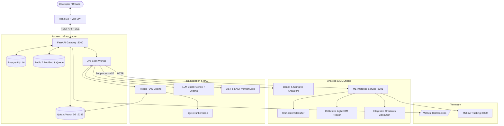

<div align="center">

# 🛡️ PatchPilot

**Evidence-Grounded Vulnerability Triage & Remediation Copilot for Python Code**

[](https://fastapi.tiangolo.com)
[](https://python.org)
[](https://react.dev)
[](https://qdrant.tech)
[](https://postgresql.org)
[](https://redis.io)
[](LICENSE)
[](#-defensive-security-guarantees)

<p align="center">
  <em>PatchPilot scans Python source files, identifies security vulnerabilities using static analysis and calibrated ML, explains findings grounded in verified CWE/NVD/OWASP documentation, highlights risky lines via Integrated Gradients, and synthesizes syntactically verified, non-regressive patches through a bounded repair loop.</em>
</p>

</div>

---

## 📑 Table of Contents

- [Executive Overview](#-executive-overview)
- [Key Features](#-key-features)
- [Defensive Security Guarantees](#-defensive-security-guarantees)
- [System Architecture](#-system-architecture)
- [Detection, Triage & Repair Pipeline](#-detection-triage--repair-pipeline)
- [Repository Structure](#-repository-structure)
- [Prerequisites & Environment](#-prerequisites--environment)
- [Quickstart Guide](#-quickstart-guide)
  - [Option A: Docker Compose (Recommended)](#option-a-docker-compose-recommended)
  - [Option B: Local Step-by-Step Setup](#option-b-local-step-by-step-setup)
- [Configuration Reference (`.env`)](#-configuration-reference-env)
- [REST API Reference](#-rest-api-reference)
- [Machine Learning & RAG Engine](#-machine-learning--rag-engine)
  - [UniXcoder + LightGBM Fusion Triager](#unixcoder--lightgbm-fusion-triager)
  - [Line Attribution via Integrated Gradients](#line-attribution-via-integrated-gradients)
  - [Hybrid Dense + Sparse RAG with Strict Citations](#hybrid-dense--sparse-rag-with-strict-citations)
  - [Bounded Verify-Repair Loop](#bounded-verify-repair-loop)
- [Development, Linting & Testing](#-development-linting--testing)
- [Evaluation & Benchmarks](#-evaluation--benchmarks)
- [Security & Responsible Disclosure](#-security--responsible-disclosure)
- [License](#-license)

---

## 🎯 Executive Overview

Modern Application Security (AppSec) tools suffer from two major pain points:
1. **Alert Fatigue:** Static Application Security Testing (SAST) tools generate overwhelming numbers of false positives with no context or confidence calibration.
2. **Hallucinated or Breaking Patches:** Generic LLM coding assistants often hallucinate CVE facts, introduce syntax errors, cause behavioral regressions, or generate dangerous exploit demonstrations.

**PatchPilot** solves both challenges through an evidence-grounded, multi-stage pipeline:
- Combines **Bandit** and **Semgrep** static rules with fine-tuned **UniXcoder** embeddings and a **LightGBM** fusion model to prioritize actionable vulnerabilities.
- Pinpoints vulnerable lines of code with **Integrated Gradients** feature attribution.
- Grounds natural-language explanations in trusted security taxonomies (CWE, NVD, OWASP) indexed in **Qdrant**, enforcing a strict **cite-or-abstain** verification policy (≥ 0.90 fuzzy match).
- Proposes minimal patches and automatically verifies them in a **bounded verify-repair state machine** (valid AST, zero analyzer regressions, lower ML risk score, max 2 retries).

---

## ✨ Key Features

- **🛡️ Multi-Engine Static Analysis:** Runs Bandit and Semgrep concurrently inside timeout-enforced, sandboxed subprocesses with AST function boundary extraction.
- **🧠 Calibrated Fusion Triager:** Fuses SAST rule confidence, code metrics, and UniXcoder code representations using an isotonic-calibrated LightGBM model.
- **🔍 Explainable AI (XAI):** Integrated Gradients attribution highlights the exact tokens and lines contributing to risk predictions.
- **📚 Hybrid RAG Evidence Grounding:** Qdrant dual-retrieval (Dense vectors + BM25 sparse vectors), fused via Reciprocal Rank Fusion (RRF) and reranked using `BAAI/bge-reranker-base`.
- **✅ Verifiable Grounding Policy:** Explanations must cite retrieved passages; every citation is string-verified against the knowledge base before presentation to the user.
- **🔄 Bounded Verify-Repair Loop:** Patches undergo multi-gate verification:
  1. Python `ast.parse()` syntax check.
  2. Subprocess re-analysis (the original finding must be resolved).
  3. Regression scan (no new high/medium severity findings introduced).
  4. Model re-scoring (predicted vulnerability probability must decrease).
- **⚡ Live Event Streaming:** Server-Sent Events (SSE) stream scan progress, findings, and patch generation status in real time.
- **🔐 Production-Grade Security & Auth:** Argon2 password hashing, secure JWT access tokens, rotating refresh tokens, rate limiting via SlowAPI, secret redaction (`detect-secrets`), and Prometheus observability.

---

## 🔒 Defensive Security Guarantees

> [!IMPORTANT]
> **PatchPilot is strictly a defensive remediation copilot.** The system adheres to rigid safety policies:
> - **Zero Code Execution:** Uploaded or pasted user code is parsed into Abstract Syntax Trees (AST) and scanned with static rules. It is **never** executed.
> - **No Exploit Generation:** System prompts, output validators, and regex filters block the creation of Proof-of-Concept (PoC) exploit scripts, payload injections, or weaponized attack strings.
> - **Automatic Secret Redaction:** Code inputs are pre-filtered with `detect-secrets` patterns before persisting to the database or passing to the LLM.
> - **Prompt Injection Guardrails:** Code inputs are wrapped in untrusted boundary tags (`<untrusted_code_to_remediate>`) with strict instruction hierarchy enforcement.

---

## 🏗️ System Architecture



---

## 🔄 Detection, Triage & Repair Pipeline

```
1. Ingestion & Pre-flight
   ├── Validate Python payload (Size limit: 2MB upload / 1MB paste)
   ├── Redact secrets (API keys, tokens, passwords)
   └── Parse AST & extract function definitions

2. Multi-Stage Detection
   ├── Bandit & Semgrep run concurrently (timeout: 30s)
   ├── Extract AST topological & complexity features
   └── UniXcoder extracts semantic code embeddings

3. Calibrated Triage
   ├── LightGBM fuses rule outputs + AST features + embeddings
   ├── Isotonic regression outputs calibrated P(Vulnerable)
   └── Integrated Gradients highlights suspicious lines

4. Evidence-Grounded Explanation (RAG)
   ├── Query built from function signature + rule ID + CWE hypotheses
   ├── Qdrant hybrid retrieval: Dense (embeddings) + Sparse (BM25)
   ├── Reciprocal Rank Fusion (RRF) combines candidates (top-20)
   ├── Cross-encoder (bge-reranker-base) selects top-3 passages
   └── LLM generates structured explanation with verified citations (≥0.90 match)

5. Bounded Verify-Repair Loop (Max 2 retries)
   ├── Attempt 0: LLM generates minimal unified diff patch
   ├── Verifier Gate 1: ast.parse() succeeds on patched code
   ├── Verifier Gate 2: Re-run Bandit/Semgrep -> finding resolved
   ├── Verifier Gate 3: Regression check -> 0 new vulnerabilities introduced
   ├── Verifier Gate 4: ML re-score -> probability decreases
   └── If any gate fails: Feed verifier error diagnostics back to LLM for retry
```

---

## 📁 Repository Structure

```
patchpilot/
├── backend/                       # Core FastAPI application
│   ├── alembic/                   # Database migrations (async SQLAlchemy)
│   ├── app/
│   │   ├── analyzers/             # Bandit & Semgrep sandboxed runners
│   │   ├── api/v1/                # Versioned API routes (auth, scans, findings, patches)
│   │   ├── core/                  # Config, database, security, Redis, metrics
│   │   ├── llm/                   # Provider-agnostic client (Gemini/Ollama) & prompts
│   │   ├── models/                # SQLAlchemy models (User, Scan, Finding, Patch, etc.)
│   │   ├── schemas/               # Pydantic v2 validation schemas
│   │   ├── services/              # Scan, Explain, Patch, RAG domain services
│   │   ├── workers/               # Arq background worker tasks & pipeline
│   │   └── main.py                # FastAPI factory, middleware, Prometheus mount
│   ├── tests/                     # Unit, integration, and security test suites
│   ├── alembic.ini                # Alembic database configuration
│   └── requirements.txt           # Python dependencies
├── frontend/                      # React 18 + TypeScript + Vite frontend
│   ├── src/
│   │   ├── api/                   # Typed API client and fetchers
│   │   ├── components/            # Reusable UI components & layouts
│   │   ├── features/              # Scan, triage, finding review, patch viewer modules
│   │   ├── hooks/                 # Custom React hooks (SSE streaming, auth)
│   │   └── styles/                # Modern design system & token definitions
│   └── package.json
├── ml/                            # Machine learning & XAI pipelines
│   ├── data/                      # Dataset loaders (DiverseVul / Big-Vul / synthetic)
│   ├── explain/                   # Captum Integrated Gradients line attribution
│   ├── features/                  # AST, complexity, and rule feature extractors
│   ├── serving/                   # FastAPI microservice for ML model inference
│   └── training/                  # UniXcoder fine-tuning & LightGBM training scripts
├── rag/                           # Knowledge retrieval engine
│   ├── ingest/                    # CWE, NVD, and OWASP data ingest pipelines
│   └── retrieval/                 # Qdrant hybrid retrieval + bge-reranker logic
├── evaluation/                    # Rigorous evaluation frameworks
│   ├── benchmarks/                # Precision, recall, ROC-AUC, ECE evaluation
│   ├── patchbench/                # Verify-repair benchmark test cases
│   └── run_eval.py                # Main benchmark CLI runner
├── docker/                        # Production & development Dockerfiles
├── docker-compose.yml             # Complete multi-service orchestration
├── Makefile                       # Developer task runner
├── .env.example                   # Environment configuration template
└── README.md                      # Project documentation
```

---

## 💻 Prerequisites & Environment

Ensure the following tools are installed on your machine:
- **Operating System:** Windows 10/11, macOS, or Ubuntu/Debian Linux
- **Python:** `3.11` or higher
- **Node.js:** `v20.x` or higher (with `npm`)
- **Docker & Docker Compose:** Docker Desktop or Docker Engine v24+
- **Static Analyzers:** `bandit` and `semgrep` CLI tools
- **LLM Access:** Google Gemini API key (or local [Ollama](https://ollama.ai) instance)

---

## 🚀 Quickstart Guide

### Option A: Docker Compose (Recommended)

1. **Clone the repository and enter the directory:**
   ```bash
   git clone https://github.com/your-org/patchpilot.git
   cd patchpilot
   ```

2. **Configure your environment variables:**
   ```bash
   cp .env.example .env
   ```
   *Edit `.env` to provide your `GEMINI_API_KEY` (or select `LLM_PROVIDER=ollama`) and a secure `JWT_SECRET`.*

3. **Launch the entire stack:**
   ```bash
   docker compose up --build -d
   ```

4. **Verify running services:**
   - **Web UI:** [http://localhost:5173](http://localhost:5173)
   - **REST API Docs (Swagger):** [http://localhost:8000/docs](http://localhost:8000/docs)
   - **Alternative Docs (ReDoc):** [http://localhost:8000/redoc](http://localhost:8000/redoc)
   - **MLflow Tracking UI:** [http://localhost:5000](http://localhost:5000)
   - **Prometheus Metrics:** [http://localhost:8000/metrics](http://localhost:8000/metrics)
   - **Qdrant Dashboard:** [http://localhost:6333/dashboard](http://localhost:6333/dashboard)

---

### Option B: Local Step-by-Step Setup

If developing without Docker containers for application code:

#### 1. Start Infrastructure Services
Start PostgreSQL, Redis, and Qdrant:
```bash
docker run -d --name patchpilot-postgres -p 5432:5432 -e POSTGRES_USER=patchpilot -e POSTGRES_PASSWORD=patchpilot -e POSTGRES_DB=patchpilot postgres:16-alpine
docker run -d --name patchpilot-redis -p 6379:6379 redis:7-alpine
docker run -d --name patchpilot-qdrant -p 6333:6333 -p 6334:6334 qdrant/qdrant:latest
```

#### 2. Set Up Python Virtual Environment
```bash
python -m venv .venv

# On Linux/macOS:
source .venv/bin/activate

# On Windows (PowerShell):
.\.venv\Scripts\Activate.ps1
```

#### 3. Install Backend & Analyzer Dependencies
```bash
pip install -r backend/requirements.txt
pip install bandit semgrep
```

#### 4. Run Database Migrations & Ingest Knowledge Base
```bash
cd backend
alembic upgrade head
cd ..

# Ingest CWE, NVD, and OWASP into Qdrant
python rag/ingest/ingest_all.py
```

#### 5. Launch Backend API & Worker
In Terminal 1 (FastAPI Server):
```bash
cd backend
uvicorn app.main:app --reload --port 8000
```

In Terminal 2 (Background Scan Worker):
```bash
cd backend
python -m app.workers.main
```

#### 6. Start the Frontend
In Terminal 3:
```bash
cd frontend
npm install
npm run dev
```

---

## ⚙️ Configuration Reference (`.env`)

| Variable | Default Value | Description |
| :--- | :--- | :--- |
| `DATABASE_URL` | `postgresql+asyncpg://patchpilot:...` | Async SQLAlchemy PostgreSQL connection string |
| `REDIS_URL` | `redis://localhost:6379/0` | Redis instance for job queueing and SSE pub/sub |
| `QDRANT_URL` | `http://localhost:6333` | Vector database endpoint for hybrid RAG |
| `ML_SERVICE_URL` | `http://localhost:8001` | ML inference microservice endpoint |
| `JWT_SECRET` | *Must be generated* | 64-character secret key for signing auth tokens |
| `JWT_ACCESS_TTL_MIN` | `15` | Expiry duration for access tokens (minutes) |
| `LLM_PROVIDER` | `gemini` | Primary LLM engine: `gemini` or `ollama` |
| `GEMINI_API_KEY` | - | Google AI Studio API key |
| `GEMINI_MODEL` | `gemini-2.0-flash` | Gemini model variant |
| `OLLAMA_BASE_URL` | `http://localhost:11434` | Local Ollama daemon address |
| `OLLAMA_MODEL` | `qwen2.5-coder:7b` | Model tag to load in Ollama |
| `RATE_LIMIT_SCAN` | `20/hour` | Maximum scan submissions per IP/user per hour |
| `DAILY_LLM_BUDGET_USD`| `5.0` | Cost ceiling for external LLM API usage |
| `MAX_UPLOAD_MB` | `2` | Maximum file size for uploaded Python scripts |
| `ARQ_WORKER_CONCURRENCY`| `4` | Number of concurrent scan workers |
| `ANALYZER_TIMEOUT_SEC`| `30` | Subprocess timeout for Bandit & Semgrep runs |

---

## 📡 REST API Reference

All primary API routes are mounted under `/api/v1`.

### 🔑 Authentication & Users
- `POST /api/v1/auth/register` — Register a new developer account.
- `POST /api/v1/auth/login` — Authenticate and receive an access token + HTTP-only refresh cookie.
- `POST /api/v1/auth/refresh` — Refresh expired access token with valid refresh token.
- `GET /api/v1/users/me` — Retrieve current authenticated user profile.

### 🔬 Projects & Scans
- `POST /api/v1/projects` — Create an isolated workspace/project.
- `GET /api/v1/projects` — List projects and scan histories.
- `POST /api/v1/scans` — Submit a code snippet or file for security scanning.
- `GET /api/v1/scans/{scan_id}` — Get scan overview, summary statistics, and status.
- `GET /api/v1/scans/{scan_id}/stream` — **Server-Sent Events (SSE)** endpoint streaming live scan progress.

### ⚠️ Findings & Explanations
- `GET /api/v1/findings?scan_id={id}` — List triaged findings filtered by severity, status, or file.
- `GET /api/v1/findings/{finding_id}` — Get granular finding details, AST span, and ML score.
- `GET /api/v1/findings/{finding_id}/attribution` — Get Integrated Gradients line/token saliency scores.
- `POST /api/v1/findings/{finding_id}/explain` — Generate evidence-grounded explanation via RAG.
- `PATCH /api/v1/findings/{finding_id}/triage` — Update triage state (`open`, `confirmed`, `false_positive`, `mitigated`).

### 🛠️ Remediation & Patches
- `POST /api/v1/patches/generate` — Trigger the bounded verify-repair loop for a finding.
- `GET /api/v1/patches/{patch_id}` — View synthesized unified diff, test output, and verifier trail.
- `POST /api/v1/patches/{patch_id}/apply` — Confirm and mark patch as accepted.

### 📊 Health & Observability
- `GET /health` — Health check verifying DB, Redis, and Qdrant connectivity.
- `GET /metrics` — Prometheus metrics (scan durations, findings count, LLM token costs).

---

## 🧠 Machine Learning & RAG Engine

### UniXcoder + LightGBM Fusion Triager
PatchPilot does not rely solely on static rules or solely on deep learning. It combines both:
1. **Rule Features:** Bandit and Semgrep confidence, severity, and rule IDs.
2. **Structural AST Metrics:** Cyclomatic complexity, nesting depth, argument counts, imports.
3. **Semantic Code Embeddings:** `microsoft/unixcoder-base` fine-tuned on Python vulnerability corpora.
4. **Calibrated Fusion:** A LightGBM classifier aggregates these features, followed by Isotonic Regression calibration. This produces a reliable probability score $P(\text{vulnerable})$ that maps to real-world risk.

### Line Attribution via Integrated Gradients
To explain **why** the model flagged a specific code fragment, PatchPilot implements Captum's Integrated Gradients:
$$\text{Attribution}_i(x) = (x_i - x'_i) \times \int_{0}^{1} \frac{\partial F(x' + \alpha(x - x'))}{\partial x_i} d\alpha$$
Token-level attributions are mapped back to source code line ranges, highlighting the exact lines responsible for the vulnerability signal in the UI.

### Hybrid Dense + Sparse RAG with Strict Citations
When explaining vulnerabilities:
1. **Query Formulation:** The query is synthesized from the AST function signature, CWE hypothesis, and rule findings.
2. **Qdrant Retrieval:** Conducts simultaneous dense vector search (Sentence-Transformers) and sparse vector search (BM25 token weights).
3. **Reciprocal Rank Fusion (RRF):** Fuses the top candidates into a unified rank:
   $$\text{RRF\_Score}(d) = \sum_{m \in M} \frac{1}{60 + \text{rank}_m(d)}$$
4. **Cross-Encoder Reranking:** `BAAI/bge-reranker-base` scores the top-20 items down to the top-3 most relevant authoritative excerpts.
5. **Cite-or-Abstain Verification:** The LLM prompt enforces quoting evidence passages verbatim. A post-processor validates that all citations achieve $\ge 0.90$ fuzzy match against the retrieved knowledge chunks. Any ungrounded claims are automatically filtered out.

### Bounded Verify-Repair Loop
PatchPilot implements an autonomous 3-attempt verify-repair loop:
```
Attempt 0: Generate patch using vulnerability diff instructions
     │
     ▼
[AST Syntax Validation] ──── Fail ───► Feed syntax error to LLM (Attempt 1)
     │ Pass
     ▼
[Re-run Bandit & Semgrep] ── Fail ───► Feed remaining SAST finding to LLM (Attempt 2)
     │ Pass
     ▼
[Regression Detection] ──── Fail ───► Reject patch: introduced new security flaws
     │ Pass
     ▼
[ML Risk Score Check] ───── Fail ───► Reject patch: risk score did not improve
     │ Pass
     ▼
[Patch Verified & Ready for Review]
```

---

## 🧪 Development, Linting & Testing

The project includes pre-configured automation tasks via `make`:

```bash
# Lint backend, ML, and RAG modules using ruff
make lint-backend

# Check type signatures using mypy
make type-check

# Run backend test suite with coverage enforcement (min 70%)
make test-backend

# Run security test suite
make test-security

# Run all tests across the repository
make test
```

---

## 📈 Evaluation & Benchmarks

Evaluate triage precision and remediation reliability using the built-in evaluation framework:

```bash
# Run fast smoke evaluation (CI mode)
make eval-smoke

# Run comprehensive benchmark suite
make eval
```

Evaluations produce structured reports in `evaluation/reports/` covering:
- **Triage Performance:** ROC-AUC, PR-AUC, F1-Score, and Expected Calibration Error (ECE).
- **Remediation Rate:** Percentage of patches passing all 4 verification gates on first vs. second attempt.
- **RAG Faithfulness:** Retrieval Recall@k and Hallucination Abstention Rate.

---

## 🛡️ Security & Responsible Disclosure

If you discover a security vulnerability within PatchPilot:
1. **Do not open a public GitHub issue.**
2. Send a detailed report to `security@patchpilot.dev`.
3. Include reproduction steps, code snippets, and environment details.
4. We aim to acknowledge receipt within 24 hours and provide a remediation plan within 72 hours.

---

## 📜 License

This project is licensed under the **MIT License**. See the [LICENSE](LICENSE) file for complete details.
